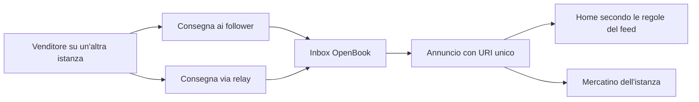

# Mercatino federato in OpenBook

Progetto in sospeso · Analisi del 28 novembre 2026

## Decisione da discutere

Un Mercatino ha senso se aiuta le comunità OpenBook a far incontrare
chi offre e chi cerca qualcosa. La ricognizione pubblica mostra un
ecosistema ActivityPub di annunci generalisti piccolo e poco attivo.
Da solo, il catalogo federato osservabile offre poche ragioni per
investire in una sezione dedicata o in adattatori tra software.

La proposta è tenere il Mercatino in valutazione e partire dalla
domanda delle comunità OpenBook. Se emerge un uso ricorrente che una
bacheca di post copre male, il primo investimento sensato è una vetrina
leggera, alimentata dai normali flussi ActivityPub dei follower e dei
relay. La compatibilità dedicata con altre piattaforme acquista valore
quando c'è una comunità interessata a scambiare annunci in entrambe le
direzioni.

## 1. Che cosa abbiamo trovato

Ricognizione del 28 novembre 2026. I numeri dei tracker derivano dai
server che riescono a censire. Le verifiche dei cataloghi fotografano
le risposte pubbliche restituite in quel momento.

| Progetto | Evidenza di utilizzo | Cosa significa per OpenBook |
| --- | --- | --- |
| **Flohmarkt** | FediDB riporta 23 istanze, 816 account registrati e 9 attivi mensili. Lo snapshot di Fediverse Observer riporta 29 istanze, 885 account registrati e 25 attivi. La wiki ufficiale elenca 27 server nella lista principale e altri 5 come offline. Il catalogo locale dell'istanza italiana consultata mostrava 43 annunci pubblici, con il più recente datato 23 ottobre. [FediDB][fedidb-floh], [Fediverse Observer][observer-floh], [wiki delle istanze][floh-instances], [catalogo locale][floh-sample]. | È il riferimento operativo più vicino per l'usato generalista. La dimensione osservata è piccola anche considerando più istanze. Un collegamento reale può comunque avere valore per una comunità specifica. |
| **Inventaire** | Fra i 50 inserimenti pubblici più recenti, creati tra il 25 e il 28 novembre, compaiono 13 profili, 30 libri prestabili, uno in regalo e 19 aggiunte all'inventario. L'outbox verificata pubblica le aggiunte come `Create(Note)` con link ai libri. La modalità di scambio è rappresentata nel catalogo Inventaire. [Campione del catalogo][inventaire-items], [API][inventaire-api], [formato delle attività][inventaire-activity]. | È un uso reale e circoscritto ai libri. Il campione mostra soprattutto prestito e inventario. Il flusso ActivityPub osservato è utile per la scoperta sociale, mentre i dati di scambio provengono dal catalogo specializzato. |
| **Menuverse** | Il catalogo pubblico elenca 18 mense e restituiva 62 piatti per il 27 novembre. Il progetto usa la FEP-0837 per pubblicare e aggregare i menu di fonti seguite. L'offerta si alimenta anche da importazioni di menu. [Progetto][menuverse-site], [fonti][menuverse-mensas], [catalogo del 27 novembre][menuverse-day], [README][menuverse-readme]. | Dimostra il funzionamento di un catalogo federato verticale. Il numero di piatti misura la copertura dei menu. L'utenza del servizio resta da stimare. |
| **Shops, ClassyFeds, Bonfire Cooperation** | Shops è il candidato generalista più vicino, con una sola istanza di sviluppo indicata nel README. ClassyFeds offre un plugin e un aggregatore di annunci per WordPress. Bonfire Cooperation documenta una demo e indica il progetto come in sviluppo. [Shops][shops], [ClassyFeds][classyfeds], [Bonfire Cooperation][bonfire-cooperation]. | Sono implementazioni da tenere d'occhio. Nelle fonti consultate manca un catalogo pubblico generalista con una base d'uso comparabile o superiore a flohmarkt. |

I contatori di flohmarkt riflettono le sessioni autenticate rilevate dalle
istanze. Chi sfoglia il catalogo senza login o segue un venditore da
un altro software resta fuori dal conteggio. Gli annunci pubblici
mostrano l'offerta visibile, con copertura diversa per ogni area.
Vendite concluse, visitatori e annunci informali pubblicati come
normali post nel Fediverso restano fuori da queste misure.
[Contatore flohmarkt][floh-active].

## 2. Come interpretare la trazione

Il dubbio sulla domanda è fondato. I dati osservati mostrano un uso
generalista limitato anche al di là di una singola istanza. L'attività
più visibile è in servizi con uno scopo preciso, un catalogo già
alimentato o una comunità attorno a un bene specifico. Avere un
protocollo comune aiuta a distribuire gli annunci. Per un mercatino di
usato locale serve anche che, nella stessa zona e nello stesso momento,
ci siano abbastanza offerte rilevanti e persone interessate.

La poca attività è compatibile sia con una domanda debole sia con una
domanda che oggi si esprime altrove, per esempio nei gruppi, nei post
informali o su mercatini già frequentati. Anche un catalogo con poca
offerta può scoraggiare chi cerca e, di riflesso, chi pubblica.
Queste sono ipotesi. I dati disponibili descrivono l'adozione delle
vetrine osservate e lasciano aperto quale fattore pesi di più.

**Prima prova di prodotto.** Individuare una comunità OpenBook che
voglia davvero usare una bacheca di annunci e partire con gli strumenti
già disponibili, ad esempio un gruppo o un hashtag concordato.
Concentrare la prova su una zona o una categoria in cui i partecipanti
possano effettivamente scambiarsi gli oggetti. Valutare
se pubblicano persone diverse, se tornano a pubblicare e se gli annunci
generano contatti utili, anche tramite riscontro volontario. Chiedere
quale difficoltà una vetrina dedicata risolverebbe, per esempio trovare
gli annunci ancora disponibili o filtrarli per zona.

Se l'uso resta sporadico, la bacheca informale è una risposta
proporzionata. Se l'uso si ripete e gli utenti incontrano gli stessi
limiti, una prima versione dovrebbe risolvere quei limiti. Per valutare
un adattatore esterno conta anche l'esistenza di un altro gruppo
interessato a scambiare annunci, con una copertura geografica utile.

## 3. Disegno tecnico se emerge un uso

La prima vetrina riguarda annunci pubblici con venditore, descrizione,
foto, zona ed eventuale prezzo o indicazione di gratuità. Home e
Mercatino presentano lo stesso annuncio. Pagamenti, ordini,
prenotazioni e accordi restano fuori dal perimetro.

### I due flussi di federazione

1. **Follower del venditore.** Quando pubblico un annuncio su OpenBook, il
   mio actor invia il `Create` ai miei follower secondo il normale flusso
   dei post. Un'altra istanza OpenBook che lo riceve lo mostra nella
   Home di chi mi segue e lo aggiunge al proprio Mercatino. `Update`
   e `Delete` riguardano lo stesso oggetto e si riflettono in entrambe
   le viste.
2. **Relay dell'istanza.** Lo stesso annuncio pubblico può raggiungere
   altre istanze tramite i relay configurati. Il Mercatino lo mostra
   anche quando nessun utente locale segue il venditore. La Home
   continua ad applicare i suoi criteri di rilevanza. Se un utente
   segue già il venditore, la consegna via relay e quella diretta
   convergono sulla stessa scheda, con una sola comparsa per vista.

I due flussi sono indipendenti. Il primo funziona anche tra due istanze
senza relay. Il secondo estende la copertura del Mercatino. Indirizzare
l'oggetto a `Public` lo rende pubblico, mentre follower e relay
determinano a quali inbox arriva. [Consegna ActivityPub][ap-delivery],
[relay OpenBook][ob-relays].

### Formato dell'annuncio e FEP-0837

La [FEP-0837][fep] è **DRAFT** nella revisione consultata (`7ba1ec7`). Usa
[Valueflows][vf] per esprimere una proposta. Un `Proposal` dichiara
`purpose: offer` per un'offerta, un intento principale `publishes` per il
bene e un eventuale intento `reciprocal` per il corrispettivo, con importo
e risorsa come la valuta. Può indicare anche un `Place`. La FEP consente di
rappresentare una proposta con un oggetto `Note` dotato dei relativi campi.
Per pubblicarla prevede collezioni pubbliche, consegna ai follower con
`Create` e rilancio da parte di un gruppo. Formato dell'annuncio e
sottoscrizione del catalogo sono quindi due aspetti del contratto.

Le implementazioni consultate combinano questi pezzi in modo diverso.
Flohmarkt `0.20.1` invia una `Note` leggibile con `flohmarkt:data` e un
`Proposal` allegato. Una sua versione precedente, `0.16.1`, usa solo il
formato storico. Menuverse riceve `Create(Note)` dagli actor che segue,
risolve il `Proposal` all'URL presente nella `Note` e usa anche l'outbox
delle fonti. La compatibilità va quindi misurata sia sul formato sia sul
modo in cui i cataloghi si raggiungono. [Serializzazione flohmarkt][floh-note],
[formato storico][floh-legacy], [consumer Menuverse][menuverse].

Il punto di partenza tecnico è un solo modello di annuncio, con il
sottoinsieme della FEP utile alla vetrina e le varianti dei peer
gestite ai bordi. L'ingresso nel Mercatino richiede una
rappresentazione strutturata riconosciuta e verificata. I post usati
nella prova con una bacheca informale sono contenuti sociali ordinari.

### Un oggetto, due destinazioni

Il venditore è l'autore del `Create` e il valore di `attributedTo`.
L'annuncio ha un URI ActivityPub stabile, una pagina Web e metadati
strutturati per il Mercatino. Per i client sociali è utile una resa
`Note` leggibile. La FEP-0837 consente un oggetto `Note` con i campi di
`Proposal`. La forma concreta va provata con i consumer, compreso
flohmarkt, che nella versione studiata usa un allegato `Proposal`
e i metadati storici nella `Note`. Il profilo condiviso deve preservare
l'identità dell'annuncio e gli ID delle attività in tutti i percorsi.
[Pubblicazione secondo la FEP-0837][fep-publishing],
[serializzazione flohmarkt][floh-note].

In uscita si risolvono prima le inbox dei follower e, per il contenuto
pubblico ammesso, anche quelle dei relay configurati. OpenBook fa già
questo per post ed eventi pubblici. I relay in stile Mastodon ricevono
l'attività firmata dall'autore. Nei protocolli con actor relay, OpenBook
usa il proprio actor tecnico esistente per gli `Announce`. Il profilo
di un nuovo actor di catalogo o di un gruppo rimane una possibile
estensione per collezioni curate.
[Consegna OpenBook][ob-delivery], [relay OpenBook][ob-relays].

### Una sola ingestione e due viste

L'inbox verifica l'attività e riconosce un annuncio strutturato da una
consegna diretta o da un relay ammesso. Un relay può provare il rilancio.
Paternità e autorizzazione a modificare l'oggetto richiedono la verifica
dell'attività originale o della risorsa canonica all'origine.

L'URI dell'oggetto guida il salvataggio e la deduplicazione. Il Mercatino
mostra gli annunci pubblici in elenco. La Home li ordina e seleziona con
le regole della timeline, a partire dal follow verso il venditore. Un
`Update` corregge lo stesso annuncio e un `Delete` lo ritira da
entrambe le viste. La decisione se rappresentare l'annuncio come post
con metadati strutturati o come oggetto con una proiezione nel feed va
presa in base al riuso effettivo del codice. In entrambi i casi deve
esserci un solo oggetto autorevole.

## 4. Riuso e costi di integrazione

Il flusso dei **Post** è il riferimento per consegna, rilevanza nel feed,
deduplicazione e relay. Gli **Eventi** forniscono un precedente per il
modello di dominio e la pagina per consultare un tipo di oggetti
federati. Si riusano inbox verificata, risoluzione degli actor, blocchi
di dominio e coda di consegna. La ricezione e la pubblicazione possono
funzionare con la coda e il cron già previsti per lo shared hosting.
[Analisi Eventi](EVENT_SUPPORT.md), [ingestione inbox][ob-processor],
[consegna][ob-delivery], [relay OpenBook][ob-relays].

| Punto | Implicazione per il progetto |
| --- | --- |
| Identità | Un URI canonico per scheda, collegato al venditore. Gli alias strutturati appartengono alla stessa scheda solo quando l'associazione è verificabile con l'origine. Ogni nuova attività ha un ID proprio nel profilo OpenBook. |
| Ritiro e ordine delle attività | Solo l'origine autorizzata può aggiornare o ritirare l'annuncio. Il `Delete` lascia una tombstone che impedisce a un retry tardivo del `Create` di farlo riapparire. Un `Undo(Announce)` revoca la distribuzione da parte di quel catalogo. Il blocco locale nasconde la scheda secondo le regole dell'istanza. |
| Visibilità e provenienza | La vetrina condivisa ammette solo annunci pubblici destinati alla pubblicazione in elenco. Si applicano le regole OpenBook per pubblici, non elencati e privati. Una consegna firmata da un catalogo prova il rilancio. Modifiche e rimozioni richiedono la verifica dell'attività originale e dell'autorità sull'oggetto. |
| Propagazione | Come prima politica ogni istanza distribuisce i propri annunci. Un catalogo aggregatore può rilanciare quelli altrui come funzione esplicita, mantenendo origine, autore e deduplicazione. Questo rende prevedibile la copertura e previene cicli di replica tra vetrine. |
| Operatività | Separare consegna HTTP, accettazione dell'oggetto e comparsa in vetrina. Una risposta `202` conferma la presa in carico. Diagnostica, retry e riconciliazione devono permettere di capire se un annuncio manca per consegna, formato o regole locali. |

### Compatibilità con altri software

#### Follow personale in flohmarkt

Nella `0.20.1` ogni venditore locale espone un actor ActivityPub
`Person` a `/users/{nome}`, risolvibile tramite WebFinger come
`@nome@dominio`. Flohmarkt accetta automaticamente il `Follow` ricevuto
nella sua inbox personale, registra il follower e recapita i nuovi
annunci pubblici alla shared inbox del suo server.
L'outbox del venditore risponde `404` nella versione studiata. Il follow
personale è quindi un flusso per gli annunci successivi, senza recupero
dello storico attraverso l'outbox. [Documentazione flohmarkt][floh-readme],
[WebFinger][floh-webfinger], [actor del venditore][floh-person],
[follow personale][floh-follow], [consegna][floh-fanout],
[outbox][floh-outbox].

C'è un dettaglio da verificare fra i due software. Oggi OpenBook preferisce
la shared inbox anche per un `Follow` mirato. Flohmarkt tratta
i `Follow` arrivati lì come richieste tra istanze e gestisce i follow
personali nella inbox del venditore. Il percorso compatibile è
`/users/{nome}/inbox`. Va verificato end-to-end insieme alla correlazione
dell'`Accept`, il cui ID è fisso per ciascun venditore nella release
studiata. [Risoluzione dell'inbox in OpenBook][ob-actor],
[shared inbox flohmarkt][floh-shared-inbox],
[inbox personale flohmarkt][floh-person-inbox], [Accept][floh-follow].

#### Collegamenti amministrativi

Flohmarkt supporta anche il `Follow` fra actor tecnici
`/users/instance`. Dopo l'approvazione, il server sorgente aggiunge
all'invio pubblico dei venditori le inbox delle istanze sottoscritte.
Il ricevente ammette in vetrina gli annunci pubblici delle origini
abilitate, secondo le sue regole. Lo scambio in entrambe le direzioni
richiede due sottoscrizioni. Un adattatore OpenBook potrebbe gestire
questo collegamento anche senza un relay comune, destinando al peer
gli annunci pubblici firmati dal venditore.
[Handshake][floh-admin], [consegna][floh-fanout], [ricezione][floh-create].

Gancio usa un modello di distribuzione a livello d'istanza per gli eventi.
Un actor `Application`, normalmente `@events@dominio`, espone gli
oggetti `Event` e gli amministratori possono seguire fonti che
alimentano il calendario condiviso. È un esempio di aggregazione
facoltativa, equivalente per l'utente alla scoperta attraverso un relay.
[Federazione di Gancio][gancio-dev], [fonti fidate][gancio-usage].

ActivityPub permette di recuperare dati tramite le collezioni di un actor,
se il server le espone. Per il collegamento tra istanze, flohmarkt avvia
l'invio degli annunci locali dopo l'`Accept`. Va provato l'ordine tra
elaborazione dell'`Accept` e prime consegne, perché l'origine può
iniziare l'invio appena riceve la conferma HTTP.
[Invio iniziale flohmarkt][floh-backfill].

### Costi noti di un eventuale adattatore flohmarkt

Il collegamento tra istanze richiede verifiche specifiche e manutenzione
al cambiare delle versioni. Il codice di flohmarkt `0.20.1` evidenzia
quattro punti da provare se esiste un'istanza con cui attivare lo scambio.

- **Handshake.** La richiesta usa un `Follow` firmato con media type
  `application/json` e ID riutilizzato. L'inbox OpenBook oggi richiede
  `application/activity+json` oppure `application/ld+json`. Vanno provati
  anche correlazione dell'`Accept`, revoca e nuova sottoscrizione. Prima
  opzione: allineamento a monte. Un eventuale adattatore deve mantenere
  le verifiche dell'inbox e avere un ambito circoscritto al collegamento.
  [Handshake flohmarkt][floh-admin], [inbox OpenBook][ob-inbox].
- **Copertura geografica.** Nel flusso automatico flohmarkt filtra
  rispetto alla zona dell'istanza e richiede coordinate per gli annunci
  in forma `Proposal`. Va verificato che l'indicazione di una zona
  approssimativa e dichiarata pubblica dal venditore sia sufficiente.
  [Controllo della zona][floh-location].
- **Aggiornamento.** Flohmarkt riusa l'ID di `Create` per `Update`.
  OpenBook deduplica per ID dell'attività. In senso opposto il consumer
  flohmarkt richiede i metadati storici per aggiornare e tratta gli
  allegati come immagini. Va verificato l'intero giro, compreso un
  secondo aggiornamento con foto. Per gli ID riusati, un allineamento
  a monte o un recupero autenticato dell'oggetto già noto è preferibile
  a una modifica della deduplicazione generale. [Serializzazione
  dell'aggiornamento][floh-update-send], [ricezione][floh-update-receive],
  [inbox OpenBook][ob-inbox].
- **Ritiro.** Flohmarkt invia una tombstone e nella consegna iniziale
  si aspetta `204`. OpenBook normalmente accoda e risponde `202`.
  La prova deve verificare che la scheda sparisca in entrambe le
  direzioni e che le code esauriscano i retry. [Consegna del
  ritiro flohmarkt][floh-delete], [inbox OpenBook][ob-inbox].

## 5. Verifiche tecniche nell'ordine di investimento

1. **Follow personale fra due OpenBook.** Seguire il venditore
   da una seconda istanza senza relay. Pubblicare un annuncio e
   controllare che compaia sia nella Home del follower sia nel Mercatino
   dell'istanza. Modifica e ritiro devono riflettersi in entrambe le
   viste. La prova deve funzionare anche scambiando il ruolo delle due
   istanze.
2. **Relay e consegne sovrapposte.** Attivare un relay fra le due
   istanze e ripetere con un venditore mai seguito. Verificare la
   comparsa nel Mercatino e il rispetto delle regole della Home.
   Provare anche un venditore seguito che arriva per entrambe le vie.
   Verificare una sola scheda, aggiornamenti, ritiro, consegne doppie
   o fuori ordine, blocchi e contenuti privati.
3. **Prova di compatibilità esterna.** Con un'istanza flohmarkt di laboratorio,
   seguire un venditore con WebFinger e `Follow/Accept` e controllare la
   consegna di un annuncio nuovo. Verificare anche la resa di una
   `Note` con annuncio su un client sociale.
4. **Scambio tra vetrine.** Se c'è un'istanza interessata allo scambio,
   provare il collegamento amministrativo nei due versi. L'annuncio
   deve apparire nella vetrina remota con autore, prezzo, zona e foto.
   Modifica e ritiro devono propagarsi. La prova chiarisce il costo
   tecnico da valutare alla luce dell'uso previsto dalle comunità.

[fedidb-floh]: https://api.fedidb.org/v1/software/flohmarkt
[observer-floh]: https://apps.fediverse.observer/allsoftwares
[floh-instances]: https://codeberg.org/flohmarkt/flohmarkt/wiki/flohmarkt-instances
[floh-sample]: https://fedimercatino.it/api/v1/item/local
[floh-active]: https://codeberg.org/flohmarkt/flohmarkt/src/tag/0.20.1/flohmarkt/auth.py#L19
[inventaire-items]: https://inventaire.io/api/items/last-public?limit=50
[inventaire-api]: https://api.inventaire.io/
[inventaire-activity]: https://github.com/inventaire/inventaire/blob/main/server/controllers/activitypub/lib/format_items_activities.ts
[menuverse-site]: https://www.54gradsoftware.de/projekte
[menuverse-mensas]: https://mahlzeitheute.de/api/mensas
[menuverse-day]: https://mahlzeitheute.de/api/proposals?day=2026-11-27
[menuverse-readme]: https://codeberg.org/54GradSoftware/menuverse/src/commit/b6d6b5364fa6997f082f58766045b12331957a99/README.md
[shops]: https://codeberg.org/potato/shops#instances
[classyfeds]: https://github.com/bunthut/federated-classifieds
[bonfire-cooperation]: https://bonfirenetworks.org/app/cooperation/
[ap-delivery]: https://www.w3.org/TR/activitypub/#delivery
[gancio-dev]: https://gancio.org/v2/dev/federation
[gancio-usage]: https://gancio.org/v2/usage/federation#following-a-trusted-source-from-gancio
[fep]: https://codeberg.org/fediverse/fep/src/commit/7ba1ec7159208520a74f063ce74a977fd0682171/fep/0837/fep-0837.md
[fep-publishing]: https://codeberg.org/fediverse/fep/src/commit/7ba1ec7159208520a74f063ce74a977fd0682171/fep/0837/fep-0837.md#publishing-a-proposal
[vf]: https://www.valueflo.ws/
[menuverse]: https://codeberg.org/54GradSoftware/menuverse/src/commit/b6d6b5364fa6997f082f58766045b12331957a99/marketplace/server/federation.ts#L418
[floh-admin]: https://codeberg.org/flohmarkt/flohmarkt/src/tag/0.20.1/flohmarkt/routes/admin.py#L69
[floh-backfill]: https://codeberg.org/flohmarkt/flohmarkt/src/tag/0.20.1/flohmarkt/routes/admin.py#L199
[floh-create]: https://codeberg.org/flohmarkt/flohmarkt/src/tag/0.20.1/flohmarkt/routes/activitypub.py#L906
[floh-location]: https://codeberg.org/flohmarkt/flohmarkt/src/tag/0.20.1/flohmarkt/routes/activitypub.py#L464
[floh-fanout]: https://codeberg.org/flohmarkt/flohmarkt/src/tag/0.20.1/flohmarkt/routes/activitypub.py#L1396
[floh-note]: https://codeberg.org/flohmarkt/flohmarkt/src/tag/0.20.1/flohmarkt/routes/activitypub.py#L1420
[floh-legacy]: https://codeberg.org/flohmarkt/flohmarkt/src/tag/0.16.1/flohmarkt/routes/activitypub.py#L1144
[floh-outbox]: https://codeberg.org/flohmarkt/flohmarkt/src/tag/0.20.1/flohmarkt/routes/activitypub.py#L1838
[floh-update-send]: https://codeberg.org/flohmarkt/flohmarkt/src/tag/0.20.1/flohmarkt/routes/activitypub.py#L1509
[floh-update-receive]: https://codeberg.org/flohmarkt/flohmarkt/src/tag/0.20.1/flohmarkt/routes/activitypub.py#L1001
[floh-delete]: https://codeberg.org/flohmarkt/flohmarkt/src/tag/0.20.1/flohmarkt/routes/activitypub.py#L1695
[ob-delivery]: ../app/Federation/Delivery/ActivityDelivery.php
[ob-relays]: ../docs/federation.it.md#relay-e-amministrazione
[ob-inbox]: ../app/Http/Controllers/Federation/InboxController.php
[floh-readme]: https://codeberg.org/flohmarkt/flohmarkt/src/tag/0.20.1/README.md#L23
[floh-webfinger]: https://codeberg.org/flohmarkt/flohmarkt/src/tag/0.20.1/flohmarkt/routes/webfinger.py#L24
[floh-person]: https://codeberg.org/flohmarkt/flohmarkt/src/tag/0.20.1/flohmarkt/routes/activitypub.py#L1918
[floh-follow]: https://codeberg.org/flohmarkt/flohmarkt/src/tag/0.20.1/flohmarkt/routes/activitypub.py#L211
[floh-shared-inbox]: https://codeberg.org/flohmarkt/flohmarkt/src/tag/0.20.1/flohmarkt/routes/activitypub.py#L1310
[floh-person-inbox]: https://codeberg.org/flohmarkt/flohmarkt/src/tag/0.20.1/flohmarkt/routes/activitypub.py#L1353
[ob-actor]: ../app/Federation/Actors/Actor.php
[ob-processor]: ../app/Federation/Inbox/InboxActivityProcessor.php
